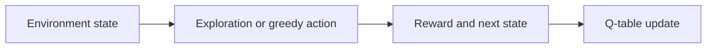
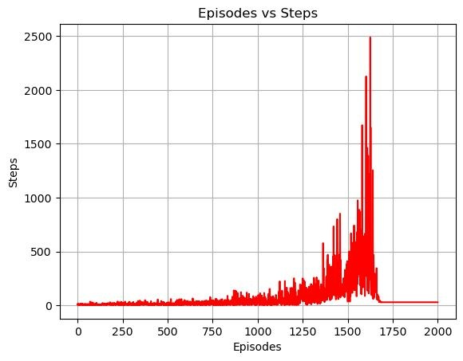
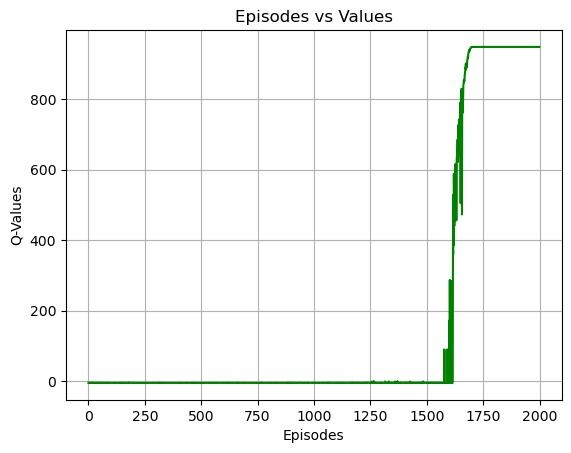

# Reinforcement Learning Exercises

### MountainCar Q-learning and a Double Q-learning grid world.

**Python · NumPy · Tabular Q-learning · Tkinter**

Value-based reinforcement learning in two settings: a MountainCar agent that learns from a discretized state space, and a Double Q-learning agent in a grid world with a Tkinter display.

*Reward per episode for the Double Q-learning agent.*

## What is included

- MountainCar action-value learning script
- Double Q-learning agent and Tkinter environment
- Episode, reward and value plots
- [double-q-learning.ipynb](double-q-learning.ipynb), [mountain_car_q.py](mountain_car_q.py) and a [source archive](source.zip) listed in [SOURCE_INDEX.md](SOURCE_INDEX.md)

## How it works

## Results

*Steps per episode during training.*

*Value estimates from the same training run.*

## Running it

Open `double-q-learning.ipynb` in a Python environment with a desktop display for Tkinter. Run `mountain_car_q.py` with Gymnasium and NumPy installed.
